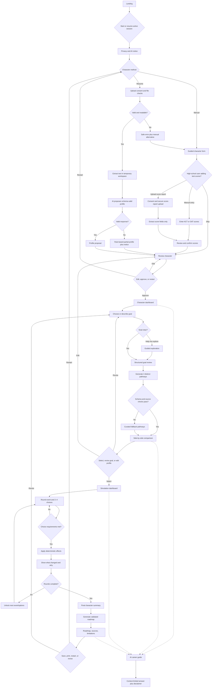
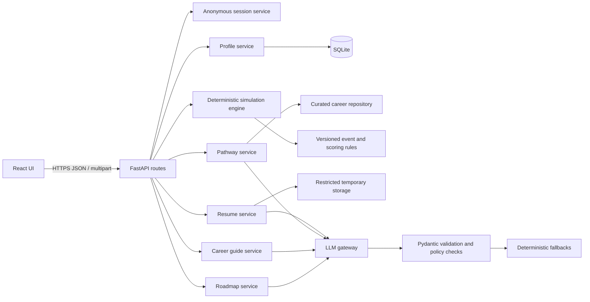

# CareerQuest Project Plan

Status: **Draft for team approval**  
Planning baseline: October 15, 2026

## 1. Product requirements summary

CareerQuest helps users understand plausible career routes, compare tradeoffs, rehearse decisions, and leave with an actionable plan. It serves users in four life stages—high school, college, graduate/professional school, and the workforce—and treats college as one option among direct employment, apprenticeships, trade programs, certificates, military service, entrepreneurship, and employer-sponsored training.

The MVP must let a first-time user:

1. Create a character manually or from a PDF, DOCX, or TXT resume.
   High-school users may also optionally enter or upload an ACT/SAT score report.
2. Review, edit, and explicitly approve all profile information and inferred gameplay traits.
3. Choose a career or lifestyle goal, including an exploratory option.
4. Compare three meaningfully distinct pathways with sourced factual claims.
5. Select a path and complete a six-round decision simulation.
6. See deterministic changes to time, money, energy, skills, experience, and network.
7. Ask an AI career guide contextual questions.
8. Receive a personalized roadmap with near-, medium-, and long-term actions.

### Product principles

- Guidance, not prediction: never guarantee admission, employment, promotion, or salary.
- User control: inferred content remains editable and is never approved silently.
- Multiple definitions of success: financial sustainability, fit, access, growth, work-life fit, wellbeing, and user priorities.
- Transparent provenance: distinguish user input, resume-extracted facts, curated facts, deterministic calculations, and AI interpretation.
- Privacy by default: resume data is session-scoped and deletable; original files are not retained.
- Deterministic core: the model writes explanations and suggestions but never calculates game state, authorizes access, or queries the database directly.
- Accessible and responsive: keyboard-first semantics, visible focus, sufficient contrast, clear labels, and non-color status cues.

### MVP boundaries

Included: one complete simulation framework, 15–25 curated careers, session persistence, safe AI fallbacks, critical automated tests, citations, methodology, privacy, and limitations.

Deferred: accounts, cloud saves, multiplayer, real-time labor data, interview practice, scholarships, localization, advanced avatars, and shareable public profiles.

### Success measures

- At least 80% of moderated first-time testers complete the happy path without help.
- All resource changes are reproducible from choice definitions.
- 100% of salary, education, licensing, and outlook claims display source and access date.
- Zero original resumes or extracted resume text persist after deletion/session expiry.
- No critical WCAG 2.2 AA issues in automated checks on required screens.
- Clean-clone setup and demo flow complete in 10 minutes or less on the instructor's machine, excluding dependency download time.

## 2. Complete user flow



Global routes available throughout: Sources & Methodology, Privacy & Limitations, Delete Resume Data, and Restart. Progress is autosaved only in the active session. Destructive actions require confirmation.

## 3. Recommended architecture

Use a small modular monolith: a React single-page application calls a FastAPI JSON API. FastAPI owns validation, session state, file parsing, deterministic simulation logic, curated career queries, and all model calls. SQLite stores curated career data and non-sensitive session state for local development; resume files and extracted text never enter SQLite. This has enough separation for testing without imposing microservice overhead.



### Key decisions

- Anonymous opaque session ID in an `HttpOnly`, `SameSite=Lax`, `Secure` cookie in production.
- API never accepts a user-supplied database ID without verifying session ownership.
- Repository layer prevents model-generated queries and makes SQLite replaceable.
- Version each ruleset, prompt, career-data record, and generated artifact for reproducibility.
- Background jobs are unnecessary for the MVP; use bounded request timeouts and explicit processing UI.
- Return stable error codes plus safe user messages; never return stack traces or resume content.
- Use an adapter-based `LLMProvider` interface and a local fallback provider for demos/tests.

## 4. Proposed folder structure

```text
careerquest/
├── frontend/
│   ├── src/
│   │   ├── app/                 # router, providers, session state
│   │   ├── components/          # shared accessible UI
│   │   ├── features/            # character, goals, paths, simulation, guide, roadmap
│   │   ├── pages/               # required route-level screens
│   │   ├── services/            # typed API client
│   │   ├── types/               # generated/shared API types
│   │   ├── styles/
│   │   └── tests/
│   ├── e2e/
│   ├── package.json
│   └── vite.config.ts
├── backend/
│   ├── app/
│   │   ├── api/                 # route modules and dependencies
│   │   ├── core/                # config, errors, logging, security
│   │   ├── schemas/             # Pydantic API/domain contracts
│   │   ├── models/              # database models only
│   │   ├── repositories/        # persistence boundaries
│   │   ├── services/            # use cases and orchestration
│   │   ├── resume/              # sniffing, extraction, cleanup
│   │   ├── simulation/          # engine, rules, events, scoring
│   │   ├── ai/                  # gateway, prompts, validators, fallbacks
│   │   ├── safety/              # provenance, injection and claim checks
│   │   ├── data/                # seeded curated career records
│   │   └── main.py
│   ├── tests/
│   │   ├── unit/
│   │   ├── integration/
│   │   ├── security/
│   │   └── fixtures/
│   └── pyproject.toml
├── data/
│   ├── careers.json
│   ├── sources.json
│   └── README.md
├── docs/
│   ├── project-plan.md
│   ├── architecture.md
│   ├── data-sources.md
│   ├── prompts.md
│   ├── privacy.md
│   ├── user-guide.md
│   ├── bug-log.md
│   ├── contributions.md
│   └── decisions/
├── scripts/                      # seed and clean-clone verification
├── .env.example
├── .gitignore
├── LICENSE
├── README.md
└── docker-compose.yml            # optional one-command local run
```

## 5. Core data schemas

The source of truth should be Pydantic models. IDs are UUIDs; timestamps are UTC ISO-8601. Every generated object records its provenance and version.

```python
class Provenance(BaseModel):
    kind: Literal["user", "resume", "curated", "ai", "rule"]
    evidence: str | None = None       # short excerpt or source label, never hidden logs
    source_id: str | None = None
    confidence: float | None = Field(None, ge=0, le=1)

class Trait(BaseModel):
    name: TraitName
    value: int = Field(ge=0, le=10)
    rationale: str
    evidence: list[Provenance] = []
    user_edited: bool = False

class CharacterProfile(BaseModel):
    id: UUID
    name: str = Field(min_length=1, max_length=80)
    life_stage: LifeStage
    education: list[EducationItem] = []
    experience: list[ExperienceItem] = []
    skills: list[Skill] = []
    interests: list[str] = []
    goals: list[str] = []
    preferences: Preferences
    constraints: Constraints
    traits: list[Trait]
    standardized_tests: list[StandardizedTestScore] = []
    provenance: dict[str, list[Provenance]]
    approval_status: Literal["draft", "approved"] = "draft"
    schema_version: str

class StandardizedTestScore(BaseModel):
    exam: Literal["ACT", "SAT"]
    test_date: date | None = None
    composite_or_total: int
    sections: dict[str, int] = {}
    superscore: bool = False
    provenance: Literal["user_entered", "uploaded_report"]
    verified_by_user: bool = False

class CareerGoal(BaseModel):
    target_outcome: str
    priorities: list[WeightedPriority]
    constraints: Constraints
    time_horizon_months: int | None = Field(None, ge=1, le=240)
    preferred_industries: list[str] = []
    uncertainties: list[str] = []

class SourceCitation(BaseModel):
    title: str
    publisher: str
    url: HttpUrl
    accessed_on: date
    supports: list[str]

class CareerPathway(BaseModel):
    id: UUID
    strategy: Literal["traditional", "lower_cost_faster", "alternative_exploratory"]
    name: str
    description: str
    fit_reasons: list[str]
    required_skills: list[str]
    required_education: list[str]
    cost: RangeEstimate
    preparation_months: RangeEstimate
    benefits: list[str]
    challenges: list[str]
    entry_roles: list[str]
    long_term_options: list[str]
    uncertainties: list[str]
    immediate_next_step: str
    citations: list[SourceCitation]

class ResourceState(BaseModel):
    time: int = Field(ge=0, le=100)
    money: int = Field(ge=0, le=100)
    energy: int = Field(ge=0, le=100)
    skills: int = Field(ge=0, le=100)
    experience: int = Field(ge=0, le=100)
    network: int = Field(ge=0, le=100)

class Effect(BaseModel):
    resource_delta: dict[ResourceName, int] = {}
    trait_delta: dict[TraitName, int] = {}
    add_flags: set[str] = set()
    add_achievements: set[str] = set()

class Choice(BaseModel):
    id: str
    label: str
    tradeoff_summary: str
    requirements: list[Requirement] = []
    effects: Effect
    next_event_rule: str | None = None

class DecisionEvent(BaseModel):
    id: str
    round_number: int = Field(ge=1, le=8)
    title: str
    situation: str
    choices: list[Choice] = Field(min_length=2, max_length=4)

class DecisionRecord(BaseModel):
    event_id: str
    choice_id: str
    before: ResourceState
    applied_effects: Effect
    after: ResourceState
    ruleset_version: str

class SimulationState(BaseModel):
    id: UUID
    round_number: int = Field(ge=1, le=8)
    selected_pathway_id: UUID
    resources: ResourceState
    traits: list[Trait]
    decisions: list[DecisionRecord] = []
    flags: set[str] = set()
    achievements: set[str] = set()
    current_event_id: str
    status: Literal["active", "complete"]

class Roadmap(BaseModel):
    character_summary: str
    important_decisions: list[str]
    developed_traits: list[str]
    remaining_gaps: list[str]
    actions_7_days: list[ActionItem] = Field(min_length=3, max_length=3)
    actions_1_to_3_months: list[ActionItem] = Field(min_length=3, max_length=3)
    long_term_milestones: list[ActionItem] = Field(min_length=3, max_length=3)
    skills_to_develop: list[str]
    experience_to_pursue: list[str]
    contacts_to_consider: list[str]
    training_to_investigate: list[str]
    alternative_pathways: list[AlternativePath] = Field(min_length=1)
    citations: list[SourceCitation]
    limitations: list[str]
```

Nested models must use bounded lengths, strict enums where appropriate, sanitized display text, and reject unknown fields on application-critical AI output. Never store protected-attribute inferences.

## 6. Resume-processing security plan

### Before upload

- Explain exactly what is extracted, whether an external AI provider receives text, session-only retention, deletion controls, and the manual alternative.
- Require affirmative consent; advise users to remove unnecessary sensitive data.
- Accept only `.pdf`, `.docx`, and `.txt`, with a proposed 5 MB limit and one file per session.

The same controls apply to optional ACT/SAT reports. Score entry must also be available manually, and skipping scores must never reduce access to features. A separate notice must explain that scores are educational records, are used only to personalize education and preparation options, and do not measure intelligence, employability, or career potential.

### Intake and isolation

- Stream to a newly created, permission-restricted temporary directory; generate the filename server-side.
- Check size while streaming; reject archive bombs and unexpected containers.
- Verify magic bytes/MIME plus parser behavior, not extension alone.
- Treat DOCX as a constrained ZIP: cap entry count, expanded size, and compression ratio; reject macros and external relationships.
- Reject encrypted, malformed, empty, image-only, or unreadable documents with a safe message and manual path.
- Do not run active content, hyperlinks, embedded objects, or system utilities from the document.

### Extraction and model use

- Use maintained libraries in-process with timeouts and page/character limits.
- Normalize control characters and remove hidden markup; preserve plain content only.
- Wrap content as untrusted data in the model request and state that instructions within it must be ignored.
- Ask only for the allowed profile schema and prohibited-inference policy.
- Send the minimum necessary text. Configure provider retention/training controls when available and document them.
- Never place resume text in URLs, analytics, traces, logs, exception messages, or test snapshots.
- For score reports, extract only exam type, test date, total/composite score, section scores, and superscore status. Ignore and discard names, addresses, registration IDs, school identifiers, barcodes, and other unrelated personal data.

### Validation and review

- Validate strict JSON against Pydantic; cap all arrays/strings and reject extra fields.
- Reject prohibited attributes and unsupported trait claims. Trait suggestions require allowed evidence.
- Escape output in the UI and never render generated HTML.
- Label extracted facts and AI interpretations separately. Require user review and approval.
- Validate ACT/SAT values against versioned exam-specific ranges, show the extracted fields for correction, and require confirmation before adding them to the profile.

### Cleanup and deletion

- Delete temporary files in a `finally` block on success, failure, timeout, and cancellation.
- Hold extracted text only in volatile session memory when possible; otherwise encrypt a short-lived record and enforce TTL cleanup.
- “Delete resume data” clears file, extracted text, derived unapproved fields, caches, and provider conversation identifiers while retaining only a non-sensitive deletion audit event.
- Provide a unified “Delete uploaded documents and scores” action. Uploaded score reports follow the same immediate cleanup and session-expiry rules as resumes.
- On startup, remove orphaned temporary files older than the maximum processing window.

### Verification controls

- Structured logging allowlist, dependency scanning, upload fuzz tests, prompt-injection corpus, cross-session authorization tests, and cleanup assertions.
- Never use real resumes in the repository; synthetic fixtures only.

## 7. Deterministic simulation design

Use six rounds for the MVP: preparation choice, experience opportunity, network/mentor decision, financial or life constraint, job/advancement decision, and resilience/next-step decision. Events are selected from versioned JSON rules based on pathway category, life stage, goal priorities, and accumulated flags.

### State and rules

- Resources use a visible 0–100 scale: time, money, energy, skills, experience, and network.
- Traits use 0–10. Low values are framed as development opportunities.
- Starting resources derive from explicit, documented mappings of user answers—not an LLM judgment.
- Each choice declares prerequisites and exact deltas. The engine validates prerequisites, applies deltas, clamps within bounds, adds flags/achievements, records before/after snapshots, and chooses the next eligible event.
- AI generates only a short explanation after the engine has produced the immutable result.

```text
validate choice belongs to current event
→ evaluate requirements against current state
→ load declared effects from trusted ruleset
→ apply effects and clamp values
→ add flags and achievements
→ record before/effect/after plus ruleset version
→ select next eligible event using ordered deterministic rules
→ request optional narrative grounded in recorded result
```

Example: `Build a portfolio project` applies `time -15, energy -10, skills +12, experience +6, career_readiness +1`, then adds `portfolio_started`. The explanation may describe the tradeoff but cannot change those values.

### Branching and fairness

- Choices are locked only by visible prerequisites and always explain how to unlock them.
- Every event has at least one feasible choice; insufficient money can never dead-end the user.
- No single resource is a universal score. End-state dimensions are calculated separately using documented weighted formulas informed by the user's priorities.
- Outcomes describe progress and tradeoffs, not winners, employability, intelligence, or moral worth.
- ACT/SAT scores may tailor suggestions about admissions preparation, placement, scholarships to investigate, or test-optional routes. They must not set gameplay traits, exclude career pathways, predict success, or rank users. Recommendations must identify test-optional and non-college alternatives where relevant.
- A fixed seed may break equivalent event ties so tests and demos are reproducible.

### End-state dimensions

Calculate 0–100 indicators for financial sustainability, career fit, skill alignment, accessibility, growth potential, work-life fit, wellbeing, and priority progress. Inputs come only from state, explicit preferences, and pathway metadata. Display the formula inputs and a plain-language caveat; do not collapse them into one prestige score.

## 8. AI prompt and validation strategy

### Supported AI tasks

Use separate prompt templates for resume-to-profile, pathway interpretation, post-decision explanation, career-guide response, and final roadmap. Each template receives only the minimum approved context, a policy block, schema/version identifiers, and a clear statement that user/resume text is untrusted data.

### Trust boundaries

- System/developer policy and application rules are fixed server-side.
- The model cannot call database, filesystem, simulation, or authorization functions.
- Curated facts are retrieved by application code and passed with source IDs; the model may not invent citations.
- Resume content and chat messages are delimited as data and cannot redefine the task.
- The guide receives an allowlisted projection of the approved profile, goal, selected path, and simulation history—not raw resume text.

### Structured-output pipeline

1. Build a typed request with prompt version and approved inputs.
2. Request provider-native structured output matching a JSON Schema.
3. Parse once; reject non-JSON and extra keys.
4. Validate with Pydantic bounds, enums, and cross-field rules.
5. Check prohibited inferences, unsupported factual claims, citation IDs, and requested counts.
6. Retry once with validation errors but no sensitive content in diagnostics.
7. If still invalid, return curated/rule-based fallback content with a transparent notice.

### Claim and citation policy

- Salary, outlook, education, licensing, cost, and duration claims must resolve to a curated source ID.
- Clearly label AI interpretation. Avoid certainty language and provide important uncertainties.
- Career guide answers include an educational-guidance disclaimer and direct high-stakes questions to qualified professionals or official sources.

### Resilience and cost

- Enforce short timeouts, bounded tokens, rate limits per session, and circuit breaking after repeated provider failure.
- Cache only non-sensitive, versioned career-data interpretations; never cache raw resume prompts.
- Tests use a fake provider with valid, malformed, refusal, timeout, injection, and rate-limit responses.

## 9. Testing strategy

### Test pyramid

- Unit: Pydantic rules, trait allocation, path diversity, scoring, effect application, event eligibility, clamping, source resolution, file sniffing, and redaction.
- Property-based: arbitrary decision sequences never exceed bounds, mutate undeclared fields, or dead-end; cleanup occurs for every parser outcome.
- Integration: API routes plus temporary SQLite, parser libraries, fake LLM, session ownership, deletion, fallback responses, and restart.
- Component: forms, review/provenance labels, comparison table, resource change announcements, loading/error states, and keyboard behavior.
- End-to-end: manual happy path, resume happy path, fallback/offline path, complete six-round simulation, guide, roadmap, edit/restart/delete.

### Security and resume matrix

Use synthetic student, limited-experience, experienced-worker, career-change, multi-column, and table-based resumes. Include empty, corrupt, encrypted, oversized, extension-spoofed, image-only, archive-bomb-like, sensitive-data, embedded-instruction, extraction-failure, invalid-JSON, timeout, refusal, and rate-limit cases. Assert no content leaks to logs and temporary storage is empty afterward.

Add synthetic ACT and SAT reports covering valid totals/sections, superscores, missing sections, historical score formats, OCR errors, conflicting totals, out-of-range values, unrelated personal identifiers, corrupted files, and prompt-injection text. Verify manual correction, explicit confirmation, deletion, and that identical profiles with different scores receive the same career-path access.

### Accessibility and UX

- Automated axe checks at desktop and mobile viewport for every required screen.
- Keyboard-only walkthrough, logical focus order, focus restoration after route/dialog changes, and visible focus.
- Screen-reader checks for form errors, progress, resource deltas, locked choices, and processing status.
- Contrast checks; icons always have text equivalents; reduced-motion preference respected.

### Quality gates

- Backend and frontend lint/type checks pass.
- Critical service modules target at least 90% branch coverage; project overall target 80%.
- All critical security, accessibility, and happy-path E2E tests pass before merge.
- Clean-clone verification runs in CI and on a second team member's machine.
- Bugs are recorded in `docs/bug-log.md` with severity, reproduction, owner, resolution, and verification.

## 10. Milestone plan

| Milestone | Outcome | Exit criteria |
|---|---|---|
| 1. Planning and foundation | Approved scope, flows, architecture, schemas, repository, CI | Approval decisions recorded; clean skeleton runs |
| 2. Manual character | Form, trait allocation, review, approval, dashboard | Unit/component tests pass; keyboard flow verified |
| 3. Secure resume processing | PDF/DOCX/TXT intake, extraction, proposal, provenance, delete | Adversarial matrix passes; temp cleanup proven |
| 4. Career data and pathways | 15–25 sourced records, goals, three-path comparison | Path diversity and citations validated |
| 5. Simulation | Six rounds, deterministic engine, branching, dashboard | Reproducible full run; no dead ends or bound errors |
| 6. AI guide and roadmap | Contextual guide, final summary, actionable roadmap, fallbacks | Schema, claim, refusal, timeout tests pass |
| 7. Hardening | E2E, accessibility, mobile, user testing, bug fixes | No open critical/high bugs; clean-clone demo passes |
| 8. Delivery | Docs, export, demo script, presentation, contribution record | Definition of done rehearsed end to end |

Work milestone by milestone on short-lived feature branches. Each pull request should contain one reviewable capability, tests, and documentation updates. Do not begin stretch work until Milestone 7 exits.

## 11. Risk register

Scale: likelihood (L) and impact (I) are Low/Medium/High.

| ID | Risk | L | I | Mitigation | Owner | Status |
|---|---|---:|---:|---|---|---|
| R1 | Scope exceeds course timeline | H | H | Freeze MVP; milestone exit gates; explicit stretch backlog | Product lead | Open |
| R2 | AI output is malformed/inconsistent | H | H | Native schemas, strict validation, one repair, deterministic fallback | AI/backend lead | Open |
| R3 | Resume data leaks or persists | M | H | Session-only processing, redacted logs, finally cleanup, deletion tests | Security lead | Open |
| R4 | Career facts become inaccurate/stale | M | H | Curated sources, access dates, claim/source checks, data review | Data lead | Open |
| R5 | Resume/chat prompt injection | H | H | Treat as data, no tools, context allowlist, adversarial tests | AI/security lead | Open |
| R6 | API cost, rate limit, or outage | M | H | Token caps, rate limits, fake/demo mode, fallback content | AI/backend lead | Open |
| R7 | File parsing fails on real resumes | H | M | Format matrix, limits, safe errors, manual alternative | Backend lead | Open |
| R8 | Trait scoring feels judgmental/opaque | M | H | Editable estimates, evidence, definitions, user research | UX lead | Open |
| R9 | Recommendations encode bias | M | H | Prohibited attributes, alternatives, constraint-aware review, audit cases | Product/AI lead | Open |
| R10 | Mobile/accessibility defects | M | H | Accessible primitives, early mobile tests, axe plus manual review | Frontend lead | Open |
| R11 | Insufficient test depth | M | H | Quality gates, risk-based matrix, CI ownership | QA lead | Open |
| R12 | Instructor setup is difficult | M | H | Pinned versions, sample env, demo mode, clean-clone CI | DevOps lead | Open |
| R13 | Team merge conflicts | M | M | Feature ownership, short branches, small PRs, shared schema review | Tech lead | Open |
| R14 | Documentation falls behind | M | M | Docs required in definition of done and PR template | Documentation lead | Open |
| R15 | Timeline leaves no presentation practice | M | M | Demo script by Milestone 6; reserve final milestone | Project manager | Open |

Owners are roles until the team assigns names. Review the register at least weekly and after each milestone.

## 12. Decisions requiring team approval

Implementation should not begin until the team records decisions for items 1–8; the rest can be finalized during Milestone 1.

1. **MVP scope:** approve the strict MVP and defer all stretch features.
2. **Stack:** approve React/TypeScript/Vite + Tailwind and FastAPI/Pydantic + SQLite.
3. **Simulation length:** approve six rounds as the MVP default.
4. **Resume retention:** approve session-only resume/file text and a 5 MB upload cap.
5. **AI provider/data terms:** approve the provider/model and verify retention/training settings allowed by the course.
6. **Demo fallback:** approve a deterministic no-key demo mode so evaluation does not depend on API availability.
7. **Career dataset:** approve the initial 15–25 occupations, source authorities, geography (proposed: United States), and data review owner.
8. **Trait model:** approve the listed 11 traits, 0–10 scale, questionnaire/mapping rules, and user editability.
9. **Persistence:** confirm anonymous active-session persistence only; no accounts for MVP.
10. **End-state scoring:** approve dimensions and transparent weighting based on user priorities.
11. **Accessibility target:** approve WCAG 2.2 AA as the practical target and assign a manual tester.
12. **Deployment:** choose instructor-local only or a hosted demo in addition to local setup.
13. **Team ownership:** assign product, frontend, backend, AI/security, data, QA, documentation, and presentation roles; record CRediT contributions.
14. **License:** choose a repository license compatible with course and data-source terms.
15. **Success measures:** approve or revise the completion, citation, privacy, accessibility, and setup targets above.

## Approval record

| Decision | Choice | Approver(s) | Date | Notes |
|---|---|---|---|---|
| MVP scope | Pending |  |  |  |
| Technology stack | Pending |  |  |  |
| Simulation design | Pending |  |  |  |
| Resume/privacy policy | Pending |  |  |  |
| ACT/SAT score policy | Pending |  |  | Optional entry/upload, allowed uses, retention |
| AI provider and fallback | Pending |  |  |  |
| Career dataset | Pending |  |  |  |
| Trait system | Pending |  |  |  |
| Deployment target | Pending |  |  |  |

Once these decisions are recorded, implementation should proceed with Milestone 1 only, preserving this plan as the baseline and documenting material changes in architecture decision records.
